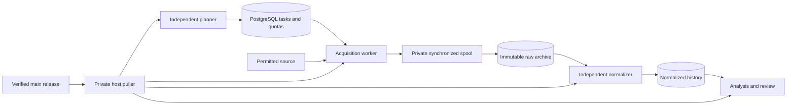

# Planned-update continuity

The approved work is tracked in [#80](https://github.com/Dan-Popescu/sm-trending-products/issues/80)
and the [delivery map](../planning/continuity-delivery.md). Worker draining and
online checkpoints were independently merged through PRs #92 and #93. This
revision assembles the remaining acquisition and release architecture.

## Runtime and evidence ownership

One application image supplies independently pinned planner, acquisition,
normalization, analysis and dashboard containers. PostgreSQL remains the task,
quota and publication authority. S3 stores immutable raw and derived evidence.

A source cursor advances only after a raw dataset commits. Normalization can
pause or fail while acquisition continues. Business-error responses are archived
without satisfying a successful capture obligation; a fenced later attempt keeps
the original sampling window. Replay preserves actual acquiring identity,
availability and missingness diagnostics. Retention and explicit source removal
remain authoritative, including for unpublished local inputs.

The planner uses the existing scheduling policy and quotas independently of
Dagster's analytical concurrency. Its ownership, queued tasks and durable cadence
commit together. Both candidate capture and candidate planner must supply their
own actual evidence before their predecessors can retire.

## Updates

Successful main CI publishes a digest-bound image and canonical signed manifest.
An explicit release-workflow deployment request adds a signed increasing sequence,
target and manifest hash. The host polls outbound HTTPS; it needs neither SSH nor
a public deployment listener. Private host configuration and deployment authority
never enter the public repository or application containers.

The controller verifies compatibility and measured overlap capacity, starts the
replacement, requires fresh raw captures for every declared collection path, and
drains its predecessor through the authoritative task admission boundary. It
retains newer evidence during rollback. Root-private sealed intent and progress
govern host actions; changing the application SQL journal cannot authorize an
update. The planner and replayable roles refresh separately through persistent
private intent, with safe restart and rollback behavior.

Use the [private controller guide](../operations/private-release-controller.md),
[processing guide](../operations/processing-releases.md) and
[capacity guide](../operations/release-capacity.md). The
[four-CPU resource template](../../deploy/production-4cpu.env.example) contains
public tuning values only. Actual secrets, addresses and account identifiers stay
in private host files.

## Qualification boundary

Native PostgreSQL/Rust/HTTP tests exercise frozen sampling windows, one-shot
pages, expired owners, source-free replay, revocation, exported snapshots and
controller crashes. The [actual Docker campaign](../operations/docker-continuity-campaign.md)
uses two immutable fixture images and real Compose operations. GitHub CI builds
the production Dockerfile before running that campaign and isolated recovery.
Fixture images and source grants remain explicitly distinct from production.

The [pilot acceptance gate #90](https://github.com/Dan-Popescu/sm-trending-products/issues/90)
still requires actual VPS/private access, production object-store configuration,
signed publication verification and approved live-source evidence. Planned
application releases keep PostgreSQL and persistent volumes in place. Whole-host
or shared-database downtime requires a separately available acquisition/control
path; two containers on one VPS do not establish that capability.
